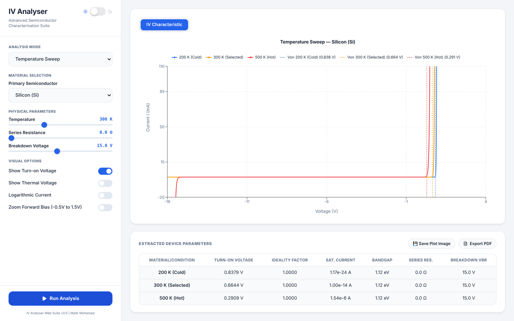

# Semiconductor IV Curve Analyser

[](https://github.com/mmalikmo07/Semiconductor-IV-Curve-Analyser-Suite/actions/workflows/ci.yml)

A browser-based simulator for diode current–voltage (IV) characteristics, with parameter extraction of the kind used in semiconductor device characterisation. It models Si, Ge, GaAs, GaN and InP diodes with series resistance, reverse breakdown and temperature dependence. From each curve it extracts turn-on voltage, ideality factor and saturation current.

**Live app:** [semiconductor-iv-curve-analyser-sui.vercel.app](https://semiconductor-iv-curve-analyser-sui.vercel.app/)


*Silicon at 200 / 300 / 500 K. Turn-on voltage falls from 0.84 V to 0.29 V as the saturation current rises with temperature.*

---

## Device model

**Forward bias, with series resistance.** The external voltage splits across the junction and the series resistance:

$$V = V_d + I R_s, \qquad I = I_s\left(e^{V_d / n V_T} - 1\right), \qquad V_T = \frac{kT}{q}$$

This is implicit in $V_d$. The left-hand side is strictly increasing in $V_d$, so the root is unique and lies in $[0, V]$. The solver uses Newton's method with a bisection fallback whenever a step would leave that interval. Across $R_s$ = 0.01–100 Ω, $n$ = 1–2 and $I_s$ = 10⁻³⁰–10⁻⁸ A, the KVL residual stays below 10⁻⁹ V. This is covered by the test suite.

**Temperature.** The saturation current is scaled with the standard SPICE diode model ($X_{TI} = 3$, $T_{nom}$ = 300 K):

$$I_s(T) = I_s(T_{nom}) \left(\frac{T}{T_{nom}}\right)^{X_{TI}/n} \exp\!\left[\frac{q E_g}{n k}\left(\frac{1}{T_{nom}} - \frac{1}{T}\right)\right]$$

The model gives silicon a forward-voltage temperature coefficient of about −2 mV/K at 1 mA, which matches the textbook value.

**Reverse breakdown.** An exponential avalanche term switches on beyond $-V_{br}$. Current is clamped to ±2 A, like an instrument compliance limit.

## Parameter extraction

- **Turn-on voltage** is the first voltage at which $I$ exceeds 1 mA.
- **Ideality factor and saturation current** come from the forward region between 1 nA and 1 mA, where $I R_s$ is still small. The fit runs in two stages:
  1. A log-linear fit of $\ln I$ against $V$ gives the starting estimate.
  2. This is refined against the full Shockley form, without the usual $e^{x} - 1 \approx e^{x}$ approximation. The refinement alternates two closed-form least-squares updates, one for $n$ and one for $I_s$, until both converge.

  Stage 2 matters whenever $I_s$ is large, as in low-bandgap materials or any hot device. There the "−1" term bends $\ln I$ across the whole fit window. A plain log-linear fit gets $n$ wrong by about 5% for Ge at 300 K and about 20% for Si at 500 K.

**Measured accuracy** (from `npm test` and the scripts behind it):

| Condition | Error in $n$ | Error in $I_s$ |
|---|---|---|
| Noise-free, all 5 materials, 200–400 K | < 0.01% | < 0.1% |
| 1% Gaussian current noise, 20 trials per material | < 1% (worst seen 0.65%) | worst seen ≈ 8% |
| Si with $R_s$ = 10 Ω | ≈ 1.4% (the $IR_s$ drop at the 1 mA edge of the window) | — |

These results check the extraction against data generated by the same model. They show that the fitting is correct, but they are not a validation against measured devices.

## Material parameters (at 300 K)

| Material | $E_g$ (eV) | $n$ | $I_s$ (A) | $V_{on}$ at 1 mA, 300 K |
|---|---|---|---|---|
| Ge | 0.67 | 1.0 | 1 × 10⁻⁸ | 0.30 V |
| Si | 1.12 | 1.0 | 1 × 10⁻¹⁴ | 0.66 V |
| InP | 1.35 | 1.2 | 1 × 10⁻¹⁵ | 0.87 V |
| GaAs | 1.42 | 1.3 | 1 × 10⁻²⁰ | 1.32 V |
| GaN | 3.40 | 2.0 | 1 × 10⁻³⁰ | 3.23 V |

$I_s$ and $n$ were chosen to give representative turn-on voltages for each material. They describe illustrative devices, not measurements of a specific part. A custom material with user-set $I_s$, $n$ and $E_g$ is also available.

## Features

- **Modes:** single material, two-material comparison, and a temperature sweep (200 K / selected / 500 K)
- **Live controls:** temperature (200–500 K), series resistance (0–100 Ω), breakdown voltage
- **Display:** linear or log current axis, a zoomed forward-bias view, turn-on and thermal-voltage markers
- **Export:** a table of extracted parameters, plus plot export as PNG and a PDF report

## Code layout

```
src/
├── physics.ts        # device model, solver, temperature scaling, parameter extraction
├── physics.test.ts   # Vitest suite: solver residuals, extraction accuracy, temperature behaviour
├── App.tsx           # UI: controls, Recharts plots, parameter table
├── exports.ts        # PNG / PDF export
└── main.tsx
```

`physics.ts` also contains `generateWaferData`, which models radial and random parameter variation across a wafer of dies. It isn't wired into the UI yet.

## Running locally

```bash
npm install
npm run dev      # http://localhost:5173
npm test         # physics test suite
npm run build
```

Built with React 19, TypeScript, Vite and Recharts.

## Possible extensions

- Recombination current (a two-diode model with $n \approx 2$) and a high-injection roll-off
- Fitting $R_s$ from the high-current region, rather than taking it as an input
- Wafer-map mode in the UI, with die-to-die parameter statistics
- Fitting uploaded measurements from real bench data

---

**Malik Mohamed**, MEng Electrical & Electronic Engineering, Cardiff University
[GitHub](https://github.com/mmalikmo07) · [LinkedIn](https://www.linkedin.com/in/malik-mohamed-eng/)
